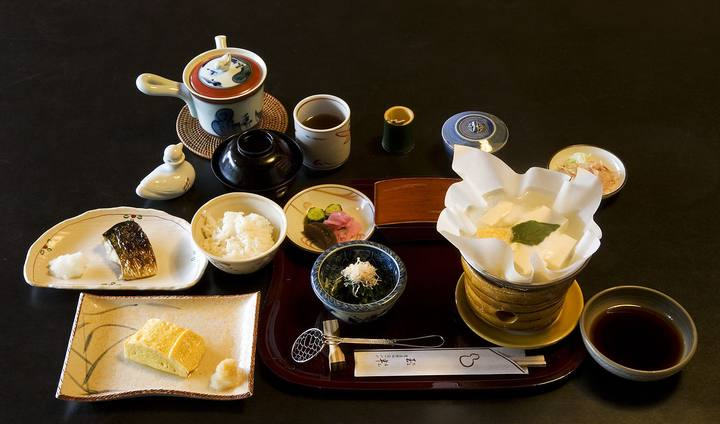
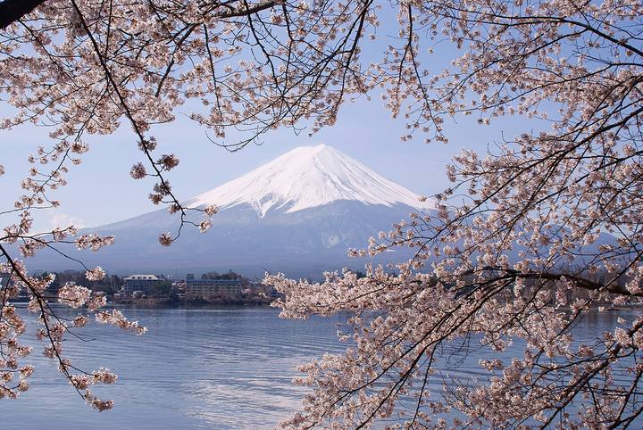

<nav class="crumb"><a href="/">子連れ宿ナビ</a> › <a href="/areas/山梨県/">山梨県</a> › <a href="/cities/富士河口湖町/">富士河口湖町</a></nav>
<header class="hero">
<figure class="ph"><picture><source media="(max-width:739px)" srcset="https://img.travel.rakuten.co.jp/HIMG/300/10731.jpg"></picture><figcaption class="credit">画像: 楽天トラベル</figcaption></figure>
<a href="https://hb.afl.rakuten.co.jp/hgc/52ba661c.11c9d9e2.52ba661d.9fa5c02a/?pc=https%3A%2F%2Fimg.travel.rakuten.co.jp%2Fimage%2Ftr%2Fapi%2Fif%2FuPw0Q%2F%3Ff_no%3D10731" target="_blank" rel="nofollow sponsored">この宿の空室・料金を見る（楽天トラベルで見る）</a>

<h1>河口湖温泉　ホテル湖龍｜富士河口湖町の子連れにやさしい宿</h1>

山梨県南都留郡富士河口湖町浅川630-1 ・ 1泊 10,197円〜

★4.32 （楽天トラベル 口コミ391件）

</header>

湖畔の温泉旅館★漫画カフェや駄菓子バイキングも人気

河口湖温泉　ホテル湖龍は、富士河口湖町にある総合★4.32（楽天トラベルの口コミ391件）の宿です。子連れ・赤ちゃん連れのご家族からは、「お部屋が広くてのびのび」・「子供が騒いでも大丈夫」といった点が口コミで支持されています。このページでは、楽天トラベルの口コミから子連れ目線のポイントをまとめました（1泊 10,197円〜）。

◎ お世話

ベビー用品・お世話しやすい設備

◎ 安全・添い寝

添い寝・小さな子も安心の部屋

◎ 食事・アレルギー

離乳食・アレルギー・部屋食など

<h2>口コミでわかる、子連れにおすすめな理由</h2>

お風呂「お風呂は他の宿では子どもには熱すぎてなかなかゆっくり入れないことが多いのですが、ここでは子どもも安心して入れる温度で快適でした」

遊び「ロビーでの駄菓子、かき氷のサービスに子どもたちは連日喜んでおりました」

設備「子ども用にかわいい巾着が用意されていたので、子供が喜んでいました」

接客「・スタッフさんの対応もよく、子どもたちがご迷惑をかけた点があったのですが快く対応してくれました」

子連れ歓迎「ロビーにはドリンク、かき氷、駄菓子の無料サービスがあり子供たちは大喜び」

食事「離乳食も暖めて頂いたりサービスも良かったです」

— 楽天トラベルの口コミより（実際に泊まったご家族の声）

<h2>この宿、子供にうれしい</h2>

お部屋が広くてのびのび

端から端まで動き回れる広さで、子供ものびのび

<h2>パパママにうれしい</h2>

子供が騒いでも大丈夫

多少さわいでも、気兼ねなく過ごせる雰囲気

貸切・家族風呂

人目を気にせず、子供と一緒にゆっくり入れる

この宿の「子連れにいい」の根拠（口コミ・公式情報）
<ul><li>口コミ小さなお子さんがかなり走り回り騒いだりして他のお客さんたちも怪訝そうなシーンを何度か見たので、静かにという注意書きなどがあると良いと思います</li><li>口コミ小さなお子さんがかなり走り回り騒いだりして他のお客さんたちも怪訝そうなシーンを何度か見たので、静かにという注意書きなどがあると良いと思います</li><li>公式公式: 風呂種別に家族風呂あり</li></ul>

<h2>お部屋</h2><figure class="ph"><figcaption class="credit">画像: 楽天トラベル</figcaption></figure>
<a href="https://hb.afl.rakuten.co.jp/hgc/52ba661c.11c9d9e2.52ba661d.9fa5c02a/?pc=https%3A%2F%2Fimg.travel.rakuten.co.jp%2Fimage%2Ftr%2Fapi%2Fif%2FuPw0Q%2F%3Ff_no%3D10731" target="_blank" rel="nofollow sponsored">客室つきプランを見る（楽天トラベルで見る）</a>

<h2>子連れにうれしい設備</h2>
湯沸かしポット加湿器(貸出)電子レンジ（一部・要予約）卓球

<h2>お食事</h2><figure class="ph"><figcaption class="credit">※写真はイメージです</figcaption></figure>
夕食はレストラン(バイキング)で。食事の口コミ評価は★4.27

<h2>お風呂</h2><figure class="ph"><figcaption class="credit">※写真はイメージです</figcaption></figure>
大浴場・露天風呂・家族風呂・天然温泉など。お風呂の口コミ評価は★4.19

<h2>子連れ目線の評価</h2>

食事4.27

お風呂4.19

客室4.12

接客4.48

立地4.32

設備4.09

<h2>泊まった人の声</h2><blockquote class="rev">「ウェルカムの駄菓子も子供たち大喜びでいろいろ考えてくださっているのが伝わってきてここに決めて良かったなと大満足でした」<cite>— 楽天トラベルの口コミより</cite></blockquote>

<h2>ほかにも、こんな口コミがありました</h2><ul class="voices"><li>子連れ歓迎「駄菓子の袋詰めは子どもになった気持ちになり選ぶ楽しさがありました」</li><li>食事「着いた途端、漫画本の多さに子供が大喜びし、食事もおいしく、スタッフの方々の応対も良く、家族皆気持ち良く過ごすことができました」</li><li>遊び「漫画本も沢山あるので子どもが喜んでいました」</li><li>子連れ歓迎「夕ごはんは料理が美味しいことはもちろん、お酒が自由に飲めたり、子どもが喜ぶ工夫がなされており、本当に感動でした」</li><li>遊び「子供達と卓球、カラオケ、漫画と遊び尽くし大変楽しい時間が過ごせました」</li><li>お風呂「子連れにおすすめ、ビュッフェ、温泉という条件でこの宿にしました」</li></ul>
— いずれも楽天トラベルに寄せられた、実際に泊まったご家族の声です。

<h2>よくある質問</h2>

赤ちゃん・子供の食事はどうなりますか？

河口湖温泉　ホテル湖龍の夕食はレストラン(バイキング)でいただけます。食事の口コミ評価は★4.27です。口コミには「夕ごはんは料理が美味しいことはもちろん、お酒が自由に飲めたり、子どもが喜ぶ工夫がなされており、本当に感動でした」といった声もありました。離乳食やアレルギー対応は宿により異なるため、予約時にご確認ください。

子連れでもお風呂に入りやすいですか？

河口湖温泉　ホテル湖龍には大浴場・露天風呂・家族風呂などがあります。貸切・家族風呂があれば、まわりを気にせず子供と入れます。

河口湖温泉　ホテル湖龍は子連れ・赤ちゃん連れにおすすめですか？

富士河口湖町にある河口湖温泉　ホテル湖龍は、楽天トラベルの口コミ391件で総合★4.32。本ページでは、その口コミから子連れ目線で評価の高かったポイントをまとめています。

<h2>このエリアの雰囲気</h2><figure class="ph"><figcaption class="credit">※写真はイメージです</figcaption></figure>

★4.32・口コミ391件のこの宿、空いてる日をチェック

<a class="btn" href="https://hb.afl.rakuten.co.jp/hgc/52ba661c.11c9d9e2.52ba661d.9fa5c02a/?pc=https%3A%2F%2Fimg.travel.rakuten.co.jp%2Fimage%2Ftr%2Fapi%2Fif%2FuPw0Q%2F%3Ff_no%3D10731" target="_blank" rel="nofollow sponsored">
空室・料金を楽天トラベルで見る →</a>
<a href="https://hb.afl.rakuten.co.jp/hgc/52ba661c.11c9d9e2.52ba661d.9fa5c02a/?pc=https%3A%2F%2Fimg.travel.rakuten.co.jp%2Fimage%2Ftr%2Fapi%2Fif%2FuPw0Q%2F%3Ff_no%3D10731" target="_blank" rel="nofollow sponsored">料金・割引クーポンも見る →</a>

※当サイトは楽天トラベルのアフィリエイトプログラムを利用しています。

#子連れ旅行 #子連れ温泉 #子連れ宿 #家族旅行 #赤ちゃん連れ旅行 #子連れ旅 #温泉旅行 #子連れお出かけ #ファミリー旅行 #子連れ宿ナビ

<footer class="credits"><h3>イメージ写真クレジット</h3><ul><li>Breakfast at Tamahan Ryokan, Kyoto.jpg by MichaelMaggs / CC BY-SA 3.0（<a href="https://upload.wikimedia.org/wikipedia/commons/thumb/f/f7/Breakfast_at_Tamahan_Ryokan%2C_Kyoto.jpg/1280px-Breakfast_at_Tamahan_Ryokan%2C_Kyoto.jpg" rel="nofollow">出典</a>）</li><li>Bokido of Hotel Urashima01o4592.jpg by 663highland / CC BY 2.5（<a href="https://upload.wikimedia.org/wikipedia/commons/thumb/a/a2/Bokido_of_Hotel_Urashima01o4592.jpg/1280px-Bokido_of_Hotel_Urashima01o4592.jpg" rel="nofollow">出典</a>）</li><li>Lake Kawaguchiko Sakura Mount Fuji 1.JPG by Midori / CC BY 3.0（<a href="https://upload.wikimedia.org/wikipedia/commons/thumb/d/df/Lake_Kawaguchiko_Sakura_Mount_Fuji_1.JPG/1280px-Lake_Kawaguchiko_Sakura_Mount_Fuji_1.JPG" rel="nofollow">出典</a>）</li></ul></footer>
