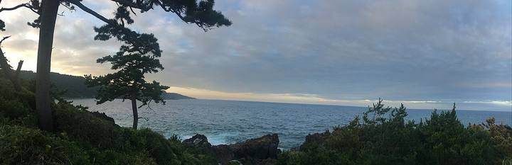

<nav class="crumb"><a href="/">子連れ宿ナビ</a> › <a href="/areas/静岡県/">静岡県</a> › <a href="/cities/伊豆の国市/">伊豆の国市</a></nav>
<header class="hero">
<figure class="ph"><picture><source media="(max-width:739px)" srcset="https://img.travel.rakuten.co.jp/HIMG/300/136241.jpg"></picture><figcaption class="credit">画像: 楽天トラベル</figcaption></figure>
<a href="https://hb.afl.rakuten.co.jp/hgc/52ba661c.11c9d9e2.52ba661d.9fa5c02a/?pc=https%3A%2F%2Fimg.travel.rakuten.co.jp%2Fimage%2Ftr%2Fapi%2Fif%2FuPw0Q%2F%3Ff_no%3D136241" target="_blank" rel="nofollow sponsored">この宿の空室・料金を見る（楽天トラベルで見る）</a>

<h1>伊豆長岡温泉　おおとり荘｜伊豆の国市の子連れにやさしい宿</h1>

静岡県伊豆の国市古奈1133 ・ 1泊 9,000円〜

★4.34 （楽天トラベル 口コミ318件）

</header>

2023年リニューアル◆温泉付きスイートOPEN◆狩野川目の前の開けた眺望の良い立地が自慢の温泉宿

伊豆長岡温泉　おおとり荘は、伊豆の国市にある総合★4.34（楽天トラベルの口コミ318件）の宿です。子連れ・赤ちゃん連れのご家族からは、「焚き火や花火で大はしゃぎ」・「貸切・家族風呂」といった点が口コミで支持されています。このページでは、楽天トラベルの口コミから子連れ目線のポイントをまとめました（1泊 9,000円〜）。

◎ お世話

ベビー用品・お世話しやすい設備

○ 安全・添い寝

添い寝・小さな子も安心の部屋

◎ 食事・アレルギー

離乳食・アレルギー・部屋食など

<h2>口コミでわかる、子連れにおすすめな理由</h2>

接客「プランの確認でお電話いただいた方の感じが良かったので、宿泊前から好印象だったのですが、伺ってからも子供達に優しく声をかけてくださって嬉しかったです」

遊び「夏ということもあり、花火やかき氷も頂き、子供たちはとても喜んでいました♬キッズルームもあるため、遊んで過ごすことが出来てありがたいです」

子連れ歓迎「工夫に富んだ副菜、子どもメニューにお刺身が付く点も嬉しく、こちらで戸田のお塩のまろやかさを知れたのも良かったです」

お風呂「お客さんが少ないタイミングだったのか温泉はほぼ貸切状態で、子供もいましたがゆっくり楽しく入れました」

接客「子どもにも優しくて、なんだかほっこりする宿でした」

遊び「花火やかき氷のサービスもあり、子供も楽しめました」

— 楽天トラベルの口コミより（実際に泊まったご家族の声）

<h2>この宿、子供にうれしい</h2>

焚き火や花火で大はしゃぎ

外遊びや花火で、子供がとびきりの笑顔に

子供が遊べる施設が充実

遊び場やアクティビティで、子供を退屈させない

<h2>パパママにうれしい</h2>

貸切・家族風呂

人目を気にせず、子供と一緒にゆっくり入れる

お部屋・個室で部屋食

人目を気にせず、子供を見ながらゆっくり食べられる

この宿の「子連れにいい」の根拠（口コミ・公式情報）
<ul><li>口コミ花火やかき氷のサービスもあり、子供も楽しめました</li><li>口コミ子連れに優しいホテルでキッズスペースのエアージムがかなり大きくで良かったのでおすすめです</li><li>口コミ初めての子供を連れての旅行でしたが、家族風呂や広いキッズルームがあって助かりました</li><li>公式公式: 夕食/朝食=部屋・個室（部屋食）</li></ul>

<h2>お部屋</h2><figure class="ph"><figcaption class="credit">画像: 楽天トラベル</figcaption></figure>
<a href="https://hb.afl.rakuten.co.jp/hgc/52ba661c.11c9d9e2.52ba661d.9fa5c02a/?pc=https%3A%2F%2Fimg.travel.rakuten.co.jp%2Fimage%2Ftr%2Fapi%2Fif%2FuPw0Q%2F%3Ff_no%3D136241" target="_blank" rel="nofollow sponsored">客室つきプランを見る（楽天トラベルで見る）</a>

<h2>子連れにうれしい設備</h2>
湯沸かしポット加湿器ベビーベッド・ベビーチェア（貸出）全室禁煙・加湿空気清浄機全室完備

<h2>お食事</h2><figure class="ph"><figcaption class="credit">※写真はイメージです</figcaption></figure>
夕食はお部屋（部屋食）・レストランで。食事の口コミ評価は★4.47

<h2>お風呂</h2><figure class="ph"><figcaption class="credit">※写真はイメージです</figcaption></figure>
大浴場・露天風呂・家族風呂・天然温泉など。お風呂の口コミ評価は★4.35

<h2>子連れ目線の評価</h2>

食事4.47

お風呂4.35

客室4.28

接客4.46

立地4.28

設備4.14

<h2>泊まった人の声</h2><blockquote class="rev">「夏ということもあり、花火やかき氷も頂き、子供たちはとても喜んでいました♬キッズルームもあるため、遊んで過ごすことが出来てありがたいです」<cite>— 楽天トラベルの口コミより</cite></blockquote>

<h2>ほかにも、こんな口コミがありました</h2><ul class="voices"><li>遊び「子供達は美味しいハンバーグに喜んでいました」</li><li>遊び「花火やお菓子やかき氷などのプレゼントがあり、子どもが喜んでました」</li><li>お風呂「初めての子供を連れての旅行でしたが、家族風呂や広いキッズルームがあって助かりました」</li><li>お部屋「小さい子供がいるので、お部屋から花火を見ることができてとても良かったです」</li><li>お風呂「特に大浴場の貸切は子連れとしては最高でした」</li><li>お部屋「あえて言うなら部屋の洗面台に子供用の足場があると◎（笑）料理は普通に美味しくお腹いっぱいになる量で子供のお子様ランチ含めこちらも満足でした」</li></ul>
— いずれも楽天トラベルに寄せられた、実際に泊まったご家族の声です。

<h2>よくある質問</h2>

赤ちゃん・子供の食事はどうなりますか？

伊豆長岡温泉　おおとり荘の夕食はお部屋（部屋食）・レストランでいただけます。食事の口コミ評価は★4.47です。口コミには「食事会場はお子様連れとそうでないグループを分けて配慮されていたようで、お互いに居心地良い滞在となっていたと思います」といった声もありました。離乳食やアレルギー対応は宿により異なるため、予約時にご確認ください。

子連れでもお風呂に入りやすいですか？

伊豆長岡温泉　おおとり荘には大浴場・露天風呂・家族風呂などがあります。貸切・家族風呂があれば、まわりを気にせず子供と入れます。

伊豆長岡温泉　おおとり荘は子連れ・赤ちゃん連れにおすすめですか？

伊豆の国市にある伊豆長岡温泉　おおとり荘は、楽天トラベルの口コミ318件で総合★4.34。本ページでは、その口コミから子連れ目線で評価の高かったポイントをまとめています。

<h2>このエリアの雰囲気</h2><figure class="ph"><figcaption class="credit">※写真はイメージです</figcaption></figure>

★4.34・口コミ318件のこの宿、空いてる日をチェック

<a class="btn" href="https://hb.afl.rakuten.co.jp/hgc/52ba661c.11c9d9e2.52ba661d.9fa5c02a/?pc=https%3A%2F%2Fimg.travel.rakuten.co.jp%2Fimage%2Ftr%2Fapi%2Fif%2FuPw0Q%2F%3Ff_no%3D136241" target="_blank" rel="nofollow sponsored">
空室・料金を楽天トラベルで見る →</a>
<a href="https://hb.afl.rakuten.co.jp/hgc/52ba661c.11c9d9e2.52ba661d.9fa5c02a/?pc=https%3A%2F%2Fimg.travel.rakuten.co.jp%2Fimage%2Ftr%2Fapi%2Fif%2FuPw0Q%2F%3Ff_no%3D136241" target="_blank" rel="nofollow sponsored">料金・割引クーポンも見る →</a>

※当サイトは楽天トラベルのアフィリエイトプログラムを利用しています。

#子連れ旅行 #子連れ温泉 #子連れ宿 #家族旅行 #赤ちゃん連れ旅行 #子連れ旅 #温泉旅行 #子連れお出かけ #ファミリー旅行 #子連れ宿ナビ #伊豆

<footer class="credits"><h3>イメージ写真クレジット</h3><ul><li>AEON-Mall-Makuhari-Shintoshin 11 2021-11.jpg by RuinDig/Yuki Uchida / CC BY 4.0（<a href="https://upload.wikimedia.org/wikipedia/commons/thumb/d/d6/AEON-Mall-Makuhari-Shintoshin_11_2021-11.jpg/1280px-AEON-Mall-Makuhari-Shintoshin_11_2021-11.jpg" rel="nofollow">出典</a>）</li><li>Bokido of Hotel Urashima01o4592.jpg by 663highland / CC BY 2.5（<a href="https://upload.wikimedia.org/wikipedia/commons/thumb/a/a2/Bokido_of_Hotel_Urashima01o4592.jpg/1280px-Bokido_of_Hotel_Urashima01o4592.jpg" rel="nofollow">出典</a>）</li><li>Izu peninsula UNESCO geopark 2022 Sept 12 various 18 34 43 702000.jpeg by Nesnad / CC BY 4.0（<a href="https://upload.wikimedia.org/wikipedia/commons/thumb/2/27/Izu_peninsula_UNESCO_geopark_2022_Sept_12_various_18_34_43_702000.jpeg/1280px-Izu_peninsula_UNESCO_geopark_2022_Sept_12_various_18_34_43_702000.jpeg" rel="nofollow">出典</a>）</li></ul></footer>
