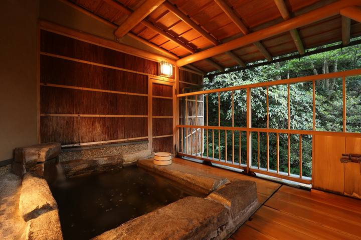
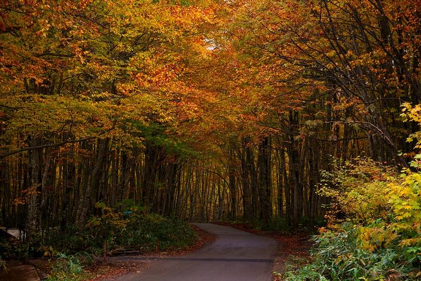

<nav class="crumb"><a href="/">子連れ宿ナビ</a> › <a href="/areas/鹿児島県/">鹿児島県</a> › <a href="/cities/霧島市/">霧島市</a></nav>
<header class="hero">
<figure class="ph"><picture><source media="(max-width:739px)" srcset="https://img.travel.rakuten.co.jp/HIMG/300/18243.jpg"></picture><figcaption class="credit">画像: 楽天トラベル</figcaption></figure>
<a href="https://hb.afl.rakuten.co.jp/hgc/52ba661c.11c9d9e2.52ba661d.9fa5c02a/?pc=https%3A%2F%2Fimg.travel.rakuten.co.jp%2Fimage%2Ftr%2Fapi%2Fif%2FuPw0Q%2F%3Ff_no%3D18243" target="_blank" rel="nofollow sponsored">この宿の空室・料金を見る（楽天トラベルで見る）</a>

<h1>湯けむりとにごり湯の宿　霧島国際ホテル｜霧島市の子連れにやさしい宿</h1>

鹿児島県霧島市牧園町高千穂3930-12 ・ 1泊 15,240円〜

★4.31 （楽天トラベル 口コミ3090件）

</header>

2026年6月1日、砂むし温泉「霧砂」オープン！＆露天風呂「白紫乃湯」リニューアルオープン！

湯けむりとにごり湯の宿　霧島国際ホテルは、霧島市にある総合★4.31（楽天トラベルの口コミ3090件）の宿です。子連れ・赤ちゃん連れのご家族からは、「子供が遊べる施設が充実」・「子供が騒いでも大丈夫」といった点が口コミで支持されています。このページでは、楽天トラベルの口コミから子連れ目線のポイントをまとめました（1泊 15,240円〜）。

◎ お世話

ベビー用品・お世話しやすい設備

○ 安全・添い寝

添い寝・小さな子も安心の部屋

◎ 食事・アレルギー

離乳食・アレルギー・部屋食など

<h2>口コミでわかる、子連れにおすすめな理由</h2>

食事「・離乳食の温め対応やバウンサーの用意、」

子連れ歓迎「子どもたちも大満足してくれました〜」

お風呂「貸切風呂を事前に予約していたので、子連れでもゆっくり温泉を楽しめました」

遊び「子供に遊び場があったのでそこで遊べたのが助かりました」

設備「欲を言えば、おつまみや子ども向けのジュースなども用意されていると、さらに満足度が高くなると思います」

お部屋「お部屋もキッズルームでホテルの中にも遊び場があり子供はとても喜んでいました」

— 楽天トラベルの口コミより（実際に泊まったご家族の声）

<h2>この宿、子供にうれしい</h2>

子供が遊べる施設が充実

遊び場やアクティビティで、子供を退屈させない

<h2>パパママにうれしい</h2>

子供が騒いでも大丈夫

多少さわいでも、気兼ねなく過ごせる雰囲気

貸切・家族風呂

人目を気にせず、子供と一緒にゆっくり入れる

この宿の「子連れにいい」の根拠（口コミ・公式情報）
<ul><li>口コミ子供は遊び場が充実していました</li><li>口コミ個室でいただいた会席料理がとても美味しく、大人4人・子ども2人でも周りを気にせず、ゆっくり食事を楽しむことができました</li><li>口コミ貸切風呂を事前に予約していたので、子連れでもゆっくり温泉を楽しめました</li></ul>

<h2>お部屋</h2><figure class="ph"><figcaption class="credit">画像: 楽天トラベル</figcaption></figure>
<a href="https://hb.afl.rakuten.co.jp/hgc/52ba661c.11c9d9e2.52ba661d.9fa5c02a/?pc=https%3A%2F%2Fimg.travel.rakuten.co.jp%2Fimage%2Ftr%2Fapi%2Fif%2FuPw0Q%2F%3Ff_no%3D18243" target="_blank" rel="nofollow sponsored">客室つきプランを見る（楽天トラベルで見る）</a>

<h2>子連れにうれしい設備</h2>
湯沸かしポットゲームコーナー卓球

<h2>お食事</h2><figure class="ph"><figcaption class="credit">※写真はイメージです</figcaption></figure>
夕食は個室・レストラン(バイキング)で。食事の口コミ評価は★4.43

<h2>お風呂</h2><figure class="ph"><figcaption class="credit">※写真はイメージです</figcaption></figure>
大浴場・露天風呂・サウナ・家族風呂など。お風呂の口コミ評価は★4.45

<h2>子連れ目線の評価</h2>

食事4.43

お風呂4.45

客室4.19

接客4.29

立地4.26

設備4.16

<h2>泊まった人の声</h2><blockquote class="rev">「子供に遊び場があったのでそこで遊べたのが助かりました」<cite>— 楽天トラベルの口コミより</cite></blockquote>

<h2>ほかにも、こんな口コミがありました</h2><ul class="voices"><li>遊び「アイスも無料で食べれるのも子供が喜んでた」</li><li>遊び「キッズスペースでは子供も楽しそうにしており連れてきて良かったなと思いました」</li><li>お部屋「とても広く部屋におもちゃもあったので飽きずに子供達も遊んでくれました」</li><li>お風呂「砂風呂も子どもは砂遊びを隣でさせてもらえるので、夫婦で堪能できてよかったです」</li><li>子連れ歓迎「遊ぶ場所もあり、ちょっとした時間子ども達は遊べてよかった」</li><li>設備「ベッドも大きめのものや2段ベッドがあったり、子どもたちが遊べるおもちゃ等があったためとても楽しんでくれました」</li></ul>
— いずれも楽天トラベルに寄せられた、実際に泊まったご家族の声です。

<h2>よくある質問</h2>

赤ちゃん・子供の食事はどうなりますか？

湯けむりとにごり湯の宿　霧島国際ホテルの夕食は個室・レストラン(バイキング)でいただけます。食事の口コミ評価は★4.43です。口コミには「・離乳食の温め対応やバウンサーの用意、」といった声もありました。離乳食やアレルギー対応は宿により異なるため、予約時にご確認ください。

子連れでもお風呂に入りやすいですか？

湯けむりとにごり湯の宿　霧島国際ホテルには大浴場・露天風呂・家族風呂などがあります。貸切・家族風呂があれば、まわりを気にせず子供と入れます。

湯けむりとにごり湯の宿　霧島国際ホテルは子連れ・赤ちゃん連れにおすすめですか？

霧島市にある湯けむりとにごり湯の宿　霧島国際ホテルは、楽天トラベルの口コミ3090件で総合★4.31。本ページでは、その口コミから子連れ目線で評価の高かったポイントをまとめています。

<h2>このエリアの雰囲気</h2><figure class="ph"><figcaption class="credit">※写真はイメージです</figcaption></figure>

★4.31・口コミ3090件のこの宿、空いてる日をチェック

<a class="btn" href="https://hb.afl.rakuten.co.jp/hgc/52ba661c.11c9d9e2.52ba661d.9fa5c02a/?pc=https%3A%2F%2Fimg.travel.rakuten.co.jp%2Fimage%2Ftr%2Fapi%2Fif%2FuPw0Q%2F%3Ff_no%3D18243" target="_blank" rel="nofollow sponsored">
空室・料金を楽天トラベルで見る →</a>
<a href="https://hb.afl.rakuten.co.jp/hgc/52ba661c.11c9d9e2.52ba661d.9fa5c02a/?pc=https%3A%2F%2Fimg.travel.rakuten.co.jp%2Fimage%2Ftr%2Fapi%2Fif%2FuPw0Q%2F%3Ff_no%3D18243" target="_blank" rel="nofollow sponsored">料金・割引クーポンも見る →</a>

※当サイトは楽天トラベルのアフィリエイトプログラムを利用しています。

#子連れ旅行 #子連れ温泉 #子連れ宿 #家族旅行 #赤ちゃん連れ旅行 #子連れ旅 #温泉旅行 #子連れお出かけ #ファミリー旅行 #子連れ宿ナビ

<footer class="credits"><h3>イメージ写真クレジット</h3><ul><li>Breakfast at Tamahan Ryokan, Kyoto.jpg by MichaelMaggs / CC BY-SA 3.0（<a href="https://upload.wikimedia.org/wikipedia/commons/thumb/f/f7/Breakfast_at_Tamahan_Ryokan%2C_Kyoto.jpg/1280px-Breakfast_at_Tamahan_Ryokan%2C_Kyoto.jpg" rel="nofollow">出典</a>）</li><li>Bokido of Hotel Urashima01o4592.jpg by 663highland / CC BY 2.5（<a href="https://upload.wikimedia.org/wikipedia/commons/thumb/a/a2/Bokido_of_Hotel_Urashima01o4592.jpg/1280px-Bokido_of_Hotel_Urashima01o4592.jpg" rel="nofollow">出典</a>）</li><li>Beech forest in Nyuto Onsenkyo (1).jpg by 掬茶 / CC BY-SA 4.0（<a href="wikimedia" rel="nofollow">出典</a>）</li></ul></footer>
