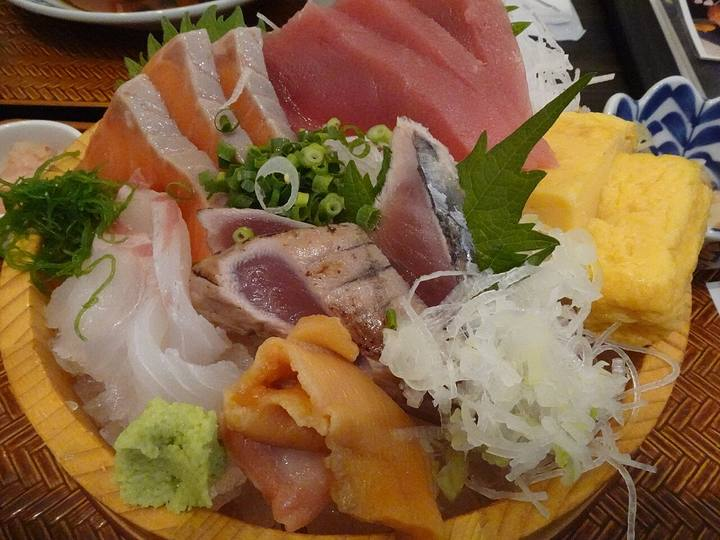
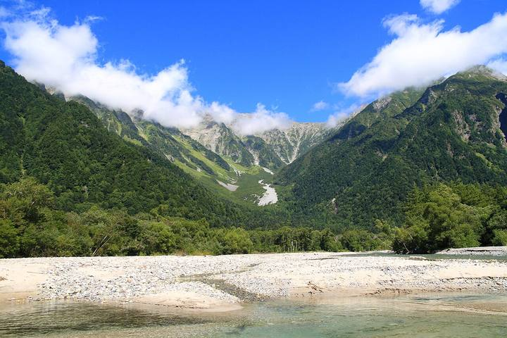

<nav class="crumb"><a href="/">子連れ宿ナビ</a> › <a href="/areas/千葉県/">千葉県</a> › <a href="/cities/浦安市/">浦安市</a></nav>
<header class="hero">
<figure class="ph"><picture><source media="(max-width:739px)" srcset="https://img.travel.rakuten.co.jp/HIMG/300/27929.jpg"></picture><figcaption class="credit">画像: 楽天トラベル</figcaption></figure>
<a href="https://hb.afl.rakuten.co.jp/hgc/52ba661c.11c9d9e2.52ba661d.9fa5c02a/?pc=https%3A%2F%2Fimg.travel.rakuten.co.jp%2Fimage%2Ftr%2Fapi%2Fif%2FuPw0Q%2F%3Ff_no%3D27929" target="_blank" rel="nofollow sponsored">この宿の空室・料金を見る（楽天トラベルで見る）</a>

<h1>東京ベイ舞浜ホテル　ファーストリゾート｜浦安市の子連れにやさしい宿</h1>

千葉県浦安市舞浜1-6 ・ 1泊 5,220円〜

★4.32 （楽天トラベル 口コミ14685件）

</header>

【舞浜】東京ディズニーリゾート(R)オフィシャルホテル

東京ベイ舞浜ホテル　ファーストリゾートは、浦安市にある総合★4.32（楽天トラベルの口コミ14685件）の宿です。子連れ・赤ちゃん連れのご家族からは、「焚き火や花火で大はしゃぎ」・「子供も安心して眠れる」といった点が口コミで支持されています。このページでは、楽天トラベルの口コミから子連れ目線のポイントをまとめました（1泊 5,220円〜）。

◎ お世話

ベビー用品・お世話しやすい設備

○ 安全・添い寝

添い寝・小さな子も安心の部屋

◎ 食事・アレルギー

離乳食・アレルギー・部屋食など

<h2>口コミでわかる、子連れにおすすめな理由</h2>

設備「子連れでしたので事前に子供向けアイテムの貸し出しをお願いしたところ、ばっちり用意してくださってました」

子連れ歓迎「子供用に事前予約で、補助便座、ベットよせのサービス、柵のサービスがあり大変助かりました」

食事「部屋には子供用のパジャマやスリッパがあり、朝食会場でも子供椅子や子供用のお皿、紙エプロンを用意していただけ、大変助かりました」

お部屋「お部屋のデザインもよく、子供はとても喜んでいました」

遊び「寝るときに天井を見上げたらブラックライトでは光る星空が描かれていて、子どもが喜んでいました」

接客「スタッフの皆さんがTDLとホテルの分別が出来てない幼児にとても優しく接して頂いたので、子供にはとても楽しい思い出になった様でした」

— 楽天トラベルの口コミより（実際に泊まったご家族の声）

<h2>この宿、子供にうれしい</h2>

焚き火や花火で大はしゃぎ

外遊びや花火で、子供がとびきりの笑顔に

スタッフが子供に優しい

子供にも気さくに接してくれる、あたたかい宿

<h2>パパママにうれしい</h2>

子供も安心して眠れる

低いベッドや布団で、添い寝もしやすい

客室にお風呂付き

子供を連れて大浴場まで歩かなくてOK

この宿の「子連れにいい」の根拠（口コミ・公式情報）
<ul><li>口コミ部屋からランドのドローンショーやシンデレラ城、花火が見えて子どもたちが大喜びでした</li><li>口コミ子供が楽しみにしていた誕生日ディズニー</li><li>口コミ子供も添い寝ではなくベッドがよかったのですごくすばらしいプランでした</li><li>口コミ子連れなので部屋風呂も広く洗い場ありなのもとても助かりました</li></ul>

<h2>子連れにうれしい設備</h2>
湯沸かしポット加湿器(貸出)加湿器(一部)

<h2>お食事</h2><figure class="ph"><figcaption class="credit">※写真はイメージです</figcaption></figure>
夕食はレストラン・レストラン(バイキング)で。食事の口コミ評価は★4.2

<h2>子連れ目線の評価</h2>

食事4.2

お風呂4.18

客室4.3

接客4.34

立地4.35

設備4.22

<h2>泊まった人の声</h2><blockquote class="rev">「エコノミールームも、子供は内装やエレベーターホールの可愛さに喜んでいましたし、テレビ前のソファもくつろげてよかったです」<cite>— 楽天トラベルの口コミより</cite></blockquote>

<h2>ほかにも、こんな口コミがありました</h2><ul class="voices"><li>お部屋「お部屋は狭いのを承知していたため、想定内でしたが、子供が船室に仕立てた部屋を見て喜んでいたのが良かった」</li><li>設備「子連れでしたが運転手さんがとても親切でベビーカーの乗せ下ろしもとても丁寧に手伝って頂き助かりました」</li><li>設備「ベビーカー＋荷物が多かったのですが、スタッフの方が荷物を部屋まで移動させてくださり、大変助かりました」</li><li>お部屋「お部屋からは、小さいですがシンデレラ城、リゾラも見えて子どもたちもとっても喜んでいました」</li><li>お風呂「お風呂とトイレが分かれていたのが、子連れにはすごく助かりました」</li><li>子連れ歓迎「ディズニーまで無料の送迎バスがあったり子連れとしては大変助かりました」</li></ul>
— いずれも楽天トラベルに寄せられた、実際に泊まったご家族の声です。

<h2>よくある質問</h2>

赤ちゃん・子供の食事はどうなりますか？

東京ベイ舞浜ホテル　ファーストリゾートの夕食はレストラン・レストラン(バイキング)でいただけます。食事の口コミ評価は★4.2です。口コミには「朝食はビュッフェで、和食・洋食・スープ・カレー・フルーツ等もあるので、子どもたちも満足でした✨️」といった声もありました。離乳食やアレルギー対応は宿により異なるため、予約時にご確認ください。

東京ベイ舞浜ホテル　ファーストリゾートは子連れ・赤ちゃん連れにおすすめですか？

浦安市にある東京ベイ舞浜ホテル　ファーストリゾートは、楽天トラベルの口コミ14685件で総合★4.32。本ページでは、その口コミから子連れ目線で評価の高かったポイントをまとめています。

<h2>このエリアの雰囲気</h2><figure class="ph"><figcaption class="credit">※写真はイメージです</figcaption></figure>

★4.32・口コミ14685件のこの宿、空いてる日をチェック

<a class="btn" href="https://hb.afl.rakuten.co.jp/hgc/52ba661c.11c9d9e2.52ba661d.9fa5c02a/?pc=https%3A%2F%2Fimg.travel.rakuten.co.jp%2Fimage%2Ftr%2Fapi%2Fif%2FuPw0Q%2F%3Ff_no%3D27929" target="_blank" rel="nofollow sponsored">
空室・料金を楽天トラベルで見る →</a>
<a href="https://hb.afl.rakuten.co.jp/hgc/52ba661c.11c9d9e2.52ba661d.9fa5c02a/?pc=https%3A%2F%2Fimg.travel.rakuten.co.jp%2Fimage%2Ftr%2Fapi%2Fif%2FuPw0Q%2F%3Ff_no%3D27929" target="_blank" rel="nofollow sponsored">料金・割引クーポンも見る →</a>

※当サイトは楽天トラベルのアフィリエイトプログラムを利用しています。

#子連れ旅行 #子連れ温泉 #子連れ宿 #家族旅行 #赤ちゃん連れ旅行 #子連れ旅 #温泉旅行 #子連れお出かけ #ファミリー旅行 #子連れ宿ナビ

<footer class="credits"><h3>イメージ写真クレジット</h3><ul><li>AEON-Mall-Makuhari-Shintoshin 11 2021-11.jpg by RuinDig/Yuki Uchida / CC BY 4.0（<a href="https://upload.wikimedia.org/wikipedia/commons/thumb/d/d6/AEON-Mall-Makuhari-Shintoshin_11_2021-11.jpg/1280px-AEON-Mall-Makuhari-Shintoshin_11_2021-11.jpg" rel="nofollow">出典</a>）</li><li>Kamikōchi, Hida Mountains range, Nagano Prefecture; September 2007 (01).jpg by skyseeker / CC BY 2.0（<a href="https://upload.wikimedia.org/wikipedia/commons/thumb/a/a7/Kamik%C5%8Dchi%2C_Hida_Mountains_range%2C_Nagano_Prefecture%3B_September_2007_%2801%29.jpg/1280px-Kamik%C5%8Dchi%2C_Hida_Mountains_range%2C_Nagano_Prefecture%3B_September_2007_%2801%29.jpg" rel="nofollow">出典</a>）</li></ul></footer>
